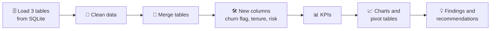
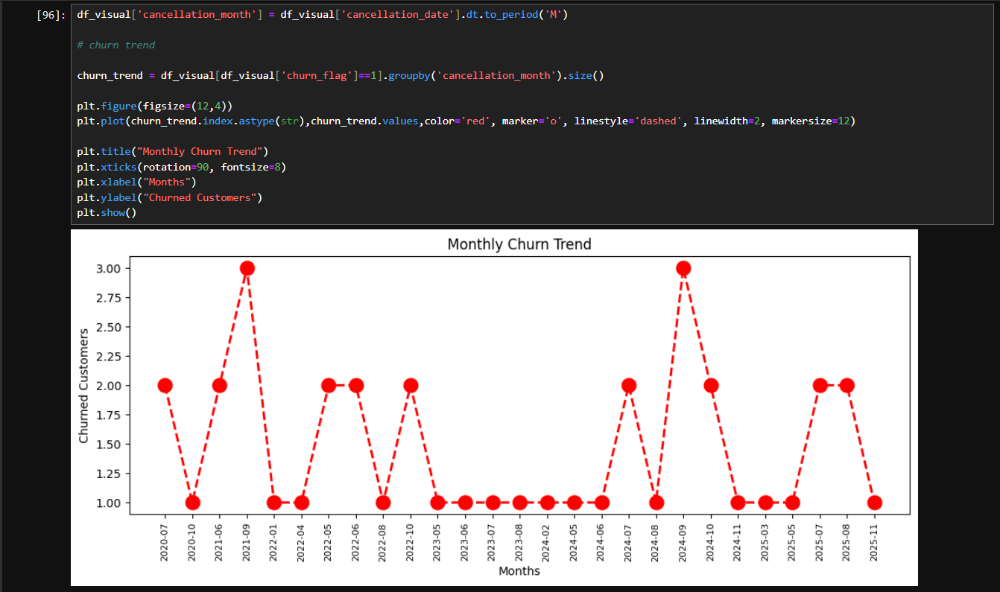
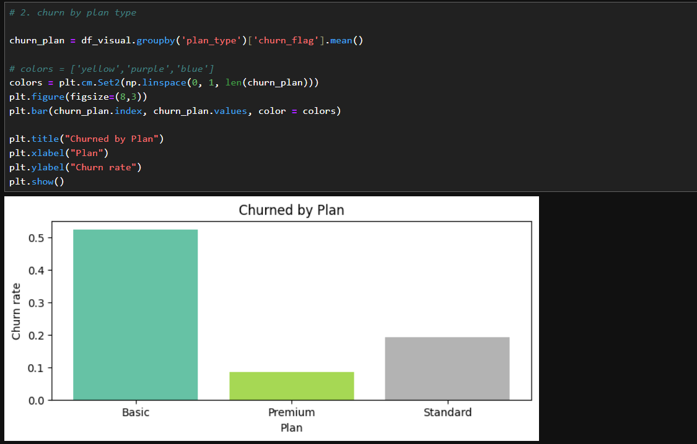
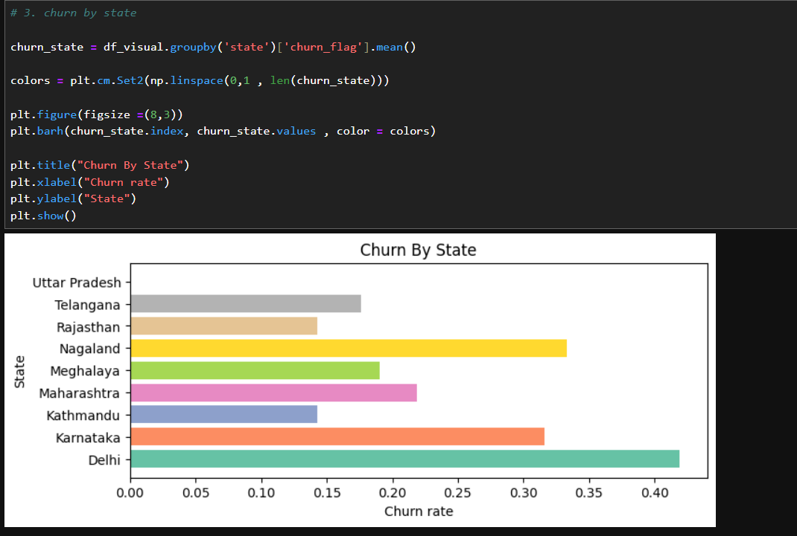
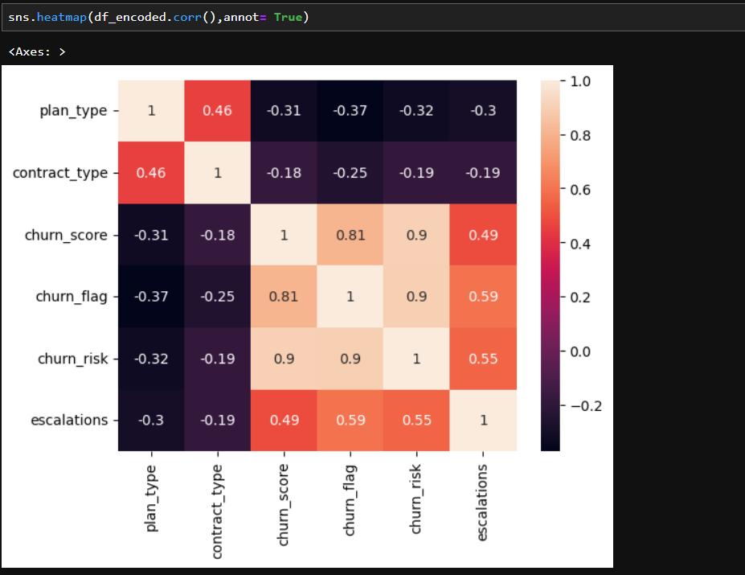

<div align="center">

# 📉 Customer Churn Analysis

### Which subscription customers cancel, and what do they have in common?


**[🎯 Problem](#-business-problem)** · **[📦 Dataset](#-dataset)** · **[🧭 Workflow](#-workflow)** · **[📊 Results](#-key-results)** · **[🖼️ Charts](#️-charts)** · **[💡 Findings](#-findings)** · **[🚀 Run it](#-how-to-run)**

</div>

---

## 🎯 Business problem
A subscription company wants to **reduce churn** (customers cancelling). This project answers four questions:

1. 📉 What are the **churn rate** and the **retention rate**?
2. 🏷️ Which **plans, subscription types and states** churn the most?
3. 📞 Do **complaints and escalations** go together with churn?
4. 💰 How much monthly **revenue is lost**, and how much is **at risk**?

## 📦 Dataset
`customer_churn.db` is a SQLite database with 3 tables:

| Table | What it holds |
|---|---|
| 👤 `db_customer` | name, state, country, gender, date of birth |
| 💳 `db_subscription` | plan, contract, charges, dates, cancellation reason, churn score |
| 🎧 `db_support` | complaint date, escalation, CSAT score |

> [!IMPORTANT]
> The database has **21 original sample customers** (`is_synthetic = 0`) and **150 generated customers** (`is_synthetic = 1`), **171 in total**. I added the generated rows for practice, so the analysis has enough rows to work with. They copy the patterns of the original rows, so **the results show how the analysis works. They are not real business findings.**

## 🧭 Workflow



<details>
<summary><b>🧹 See the cleaning steps</b></summary>

- Dropped empty columns (`pincode`, `interests`, `col_1`, `comment`)
- Fixed gender labels: `Men` and `Women` to `Male` and `Female`
- Filled missing countries from the state (Delhi and Telangana to India, Kathmandu to Nepal)
- Converted text dates to real dates
- Renamed `name` to `customer_name`
- Fixed the `Refferal` spelling to `Referral`
- Kept the latest complaint per customer and counted complaints, so the merge has one row per customer

</details>

## 📊 Key results

| 📉 Churn rate | ✅ Retention rate | 💵 Avg monthly charge | ⏳ Avg tenure |
|:---:|:---:|:---:|:---:|
| **23.39%** | **76.61%** | **16.55** | **~1,421 days** |

| 🚨 Escalation rate | 📞 Complaints per customer | 💸 Monthly revenue lost | ⚠️ Active customers at risk |
|:---:|:---:|:---:|:---:|
| **15.79%** | **0.36** | **515.60** | **30** (revenue 524.70) |

**Churn by plan:** 🔴 Basic **52%** · 🟡 Standard **19%** · 🟢 Premium **9%**
**Churn by subscription type:** 🔴 Referral **42%** · 🟡 Paid **19%** · 🟢 Organic **15%**
**Escalations vs churn (correlation):** **0.59**

## 🖼️ Charts

<table>
  <tr>
    <td align="center"><b>📈 Monthly churn trend</b><br></td>
    <td align="center"><b>🏷️ Churn by plan</b><br></td>
  </tr>
  <tr>
    <td align="center"><b>🗺️ Churn by state</b><br></td>
    <td align="center"><b>🔥 Correlation heatmap</b><br></td>
  </tr>
</table>

## 💡 Findings

- 🔴 **Basic plan customers churn the most**, and Premium customers the least.
- 📅 **Annual contracts** go together with lower churn than monthly contracts.
- 📞 Customers with an **escalated complaint** churn more.
- 🤝 Customers who joined through **referral** churn more than organic or paid customers.
- 🎯 The **churn score is a good signal**: customers with a high score are the ones who cancel.

## ✅ Recommendations

1. 🎁 Focus retention offers, such as a discount or an upgrade trial, on **Basic plan** customers.
2. 🧭 Review how **referral customers** are onboarded, because many of them leave.
3. ⚡ Contact customers quickly after an **escalated complaint**.
4. 📲 Call the **30 active customers** with medium or high churn risk before their renewal date.

<details>
<summary><b>⚠️ Limitations (please read)</b></summary>

- 150 of the 171 rows are generated, so results mirror the patterns of the 21 original rows.
- Correlation shows a link, not a cause.
- Only some customers have complaint records. Customers with no complaint are counted as "no escalation".
- One monthly charge of 92.99 in the original data looks like a typing mistake, because other Premium charges are about 20 to 23. I did not change it.
- Churn risk is created from the churn score, so their high correlation is expected and is not a finding.

</details>

## 🚀 How to run

1. Put `customer_churn.db` and `Churn_Analysis_project_fixed.ipynb` in the **same folder**.
2. Open the notebook in Jupyter.
3. Click **Kernel, then Restart & Run All**.

## 📁 Files

```text
├── Churn_Analysis_project_fixed.ipynb   # the full analysis
├── customer_churn.db                    # SQLite database (3 tables)
├── images/                              # charts used in this README
└── README.md
```

---

<div align="center">

### 👋 Ansari Mohd Rizwan
Aspiring Data Analyst · Mumbai, India

[](https://github.com/ansarimohdrizwan24-dev)
[](https://www.linkedin.com/in/ansari-mohd-rizwan-3baa7b26a)
[](https://rizwan-ansari-portfolio.netlify.app)

⭐ If you found this project useful, please give it a star.

</div>
