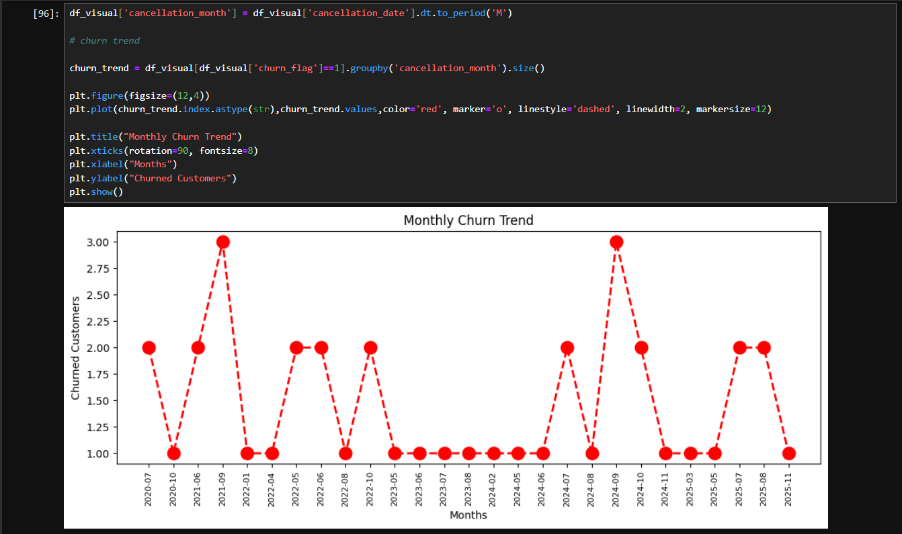
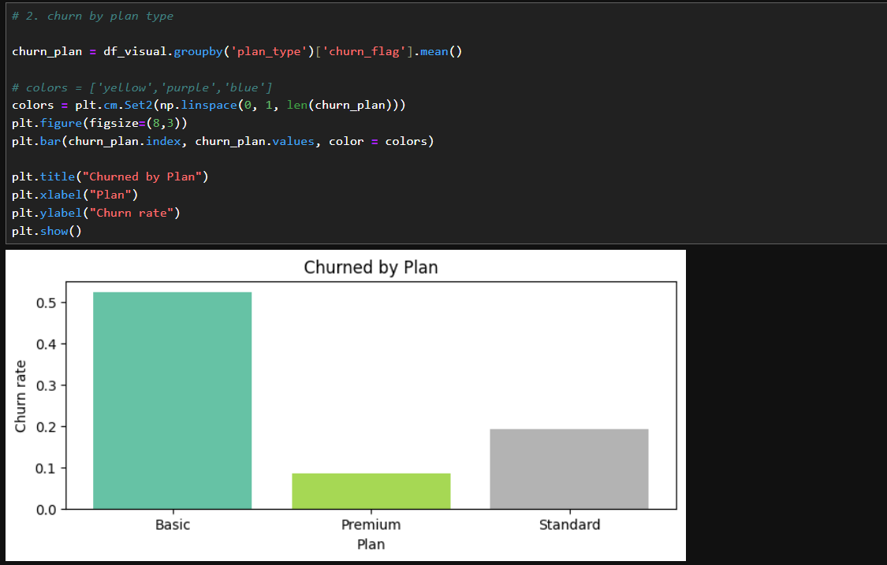
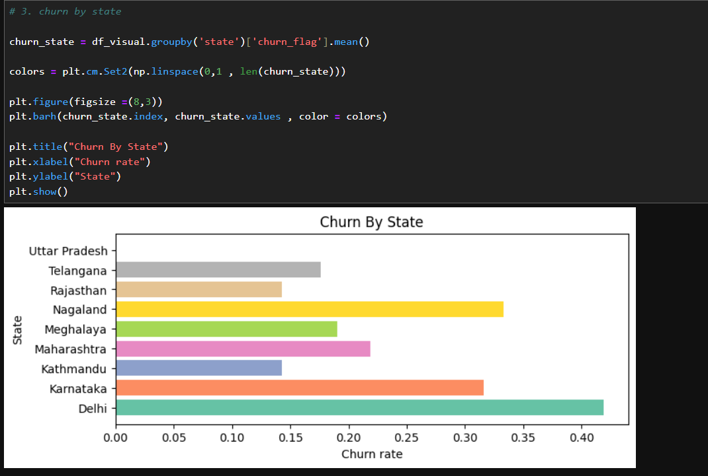
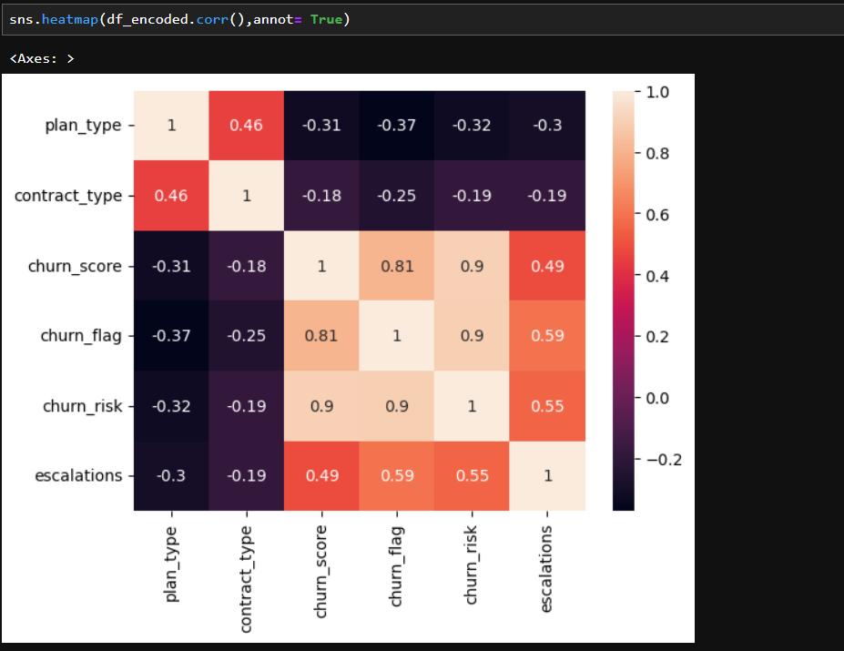

# Customer Churn Analysis (Python + SQLite)

Which subscription customers cancel, and what do they have in common? This project reads a small SQLite database, cleans and merges three tables with Pandas, calculates churn KPIs, and shows the patterns in charts.

## Business problem
A subscription company wants to reduce churn (customers cancelling). The analysis answers:
1. What are the churn rate and the retention rate?
2. Which plans, subscription types and states churn the most?
3. Do complaints and escalations go together with churn?
4. How much monthly revenue is lost, and how much is at risk?

## Dataset (please read)
- `customer_churn.db` is a SQLite database with 3 tables: `db_customer`, `db_subscription`, `db_support`.
- It has **21 original sample customers** (`is_synthetic = 0`) and **150 generated customers** (`is_synthetic = 1`), 171 in total. I added the generated rows for practice, so the analysis has enough rows to work with.
- The generated rows copy the patterns of the original rows. **The results show how the analysis works. They are not real business findings.**

## Tools
Python, Pandas, NumPy, Matplotlib, Seaborn, SQLite (`sqlite3`), Jupyter Notebook.

## What I did
1. Loaded the 3 tables from the database into dataframes.
2. **Cleaned the data:** dropped empty columns, fixed gender labels (Men and Women to Male and Female), fixed missing countries from the state, converted text dates to dates, renamed columns, fixed the "Refferal" spelling.
3. **Merged** customer, subscription and support data into one table. Kept the latest complaint per customer and counted complaints.
4. **Created new columns:** churn flag, tenure in days, churn risk (low, med, high).
5. **Calculated KPIs**, then built charts and pivot tables.

## Key results
| Metric | Value |
|---|---|
| Churn rate | 23.39% |
| Retention rate | 76.61% |
| Average monthly charge | 16.55 |
| Average tenure (to 31 Dec 2025) | about 1,421 days |
| Escalation rate | 15.79% |
| Average complaints per customer | 0.36 |
| Monthly revenue lost from churned customers | 515.60 |
| Active customers at medium or high risk | 30 (monthly revenue 524.70) |

**Churn by plan:** Basic 52%, Standard 19%, Premium 9%.
**Churn by subscription type:** Referral 42%, Paid 19%, Organic 15%.
**Correlation between escalations and churn:** 0.59.

## Screenshots
### Monthly churn trend

### Churn by plan

### Churn by state

### Correlation heatmap

How the columns were encoded before the heatmap (ordered codes, not alphabetical, so the correlations make sense):

## Findings
- Basic plan customers churn the most, and Premium customers the least.
- Annual contracts go together with lower churn than monthly contracts.
- Customers with an escalated complaint churn more.
- Customers who joined through referral churn more than organic or paid customers.
- The churn score is a good signal: customers with a high score are the ones who cancel.

## Recommendations
1. Focus retention offers, such as a discount or an upgrade trial, on Basic plan customers.
2. Review how referral customers are onboarded, because many of them leave.
3. Contact customers quickly after an escalated complaint.
4. Call the 30 active customers with medium or high churn risk before their renewal date.

## Limitations
- 150 of the 171 rows are generated, so results mirror the patterns of the 21 original rows.
- Correlation shows a link, not a cause.
- Only some customers have complaint records. Customers with no complaint are counted as "no escalation".
- One monthly charge of 92.99 in the original data looks like a typing mistake, because other Premium charges are about 20 to 23. I did not change it.
- Churn risk is created from the churn score, so their high correlation is expected and is not a finding.

## How to run
1. Put `customer_churn.db` and `Churn_Analysis_project_fixed.ipynb` in the same folder.
2. Open the notebook in Jupyter and click **Kernel, then Restart & Run All**.

## Files
- `Churn_Analysis_project_fixed.ipynb` : the full analysis
- `customer_churn.db` : the database
- `images/` : screenshots used in this README

## Credit
Built while following a tutorial by Rishabh Mishra, then extended with my own fixes, written findings and recommendations.
